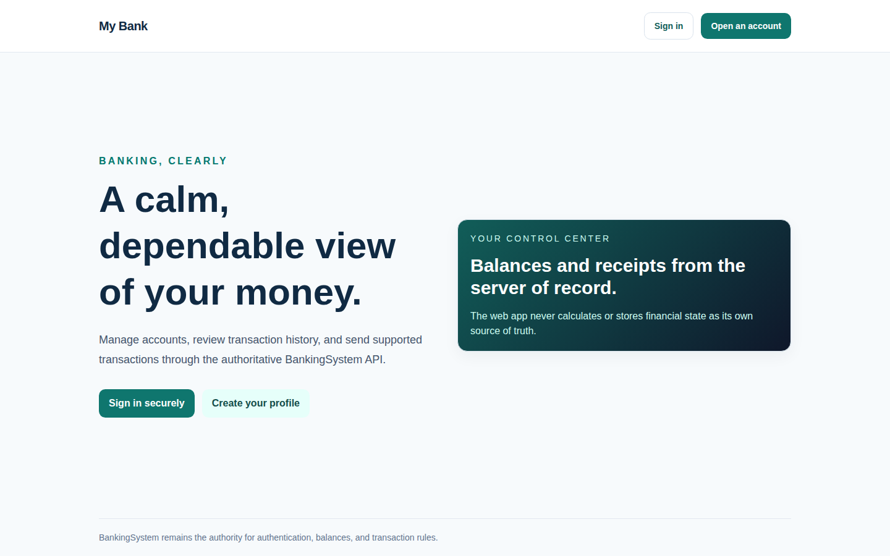

# Banking Platform

A role-based banking web application for opening accounts, completing identity verification, and moving LKR between accounts inside the same bank. Customers can confirm a payment and recover its committed receipt even if the original response is lost. Tellers, managers, and administrators use separate workspaces with permissions enforced by the banking API.



[Local setup](docs/local-development.md) · [Architecture](docs/architecture.md) · [Screenshot gallery](docs/screenshots.md) · [Portfolio copy and demo walkthrough](docs/portfolio-presentation.md)

## Engineering highlights

- **One authority for balances.** The web client sends decimal strings and displays the amounts returned by bank-core. The existing transfer engine commits the debit, credit, balanced double-entry postings, account history, and idempotency receipt in one MySQL transaction.
- **Recoverable writes.** Customer account opening and financial submissions use server-side idempotency. For internal Pay, a read-only lookup with the original key can recover the receipt without sending another payment. The receipt separates the balance at posting from the latest balance.
- **Server-owned access.** The same-origin Next.js backend-for-frontend (BFF) keeps the bank-core JWT in an HttpOnly session cookie and attaches it to upstream requests. CSRF protects browser writes. Core enforces roles and ownership and revokes existing sessions when supported role or staff-status changes commit.
- **Separate identity verification.** Customers submit documents through protected routes. Bank-core owns the case and its final status. The FastAPI service contributes document and identity checks, and an Admin can decide eligible cases.

## What each role can do

| Role | Implemented workflows |
| --- | --- |
| **CUSTOMER** | Register, verify email, reset a password, submit KYC and track its status. After approval, complete the customer record and open a savings, checking, or fixed deposit account. View balances and account history, download history as CSV, deposit, withdraw, transfer, and use Pay. |
| **TELLER** | Find, create, and update customer records. Open an account for an eligible customer using the linked user UUID. Browse accounts and history, update account details, and close eligible accounts at exact zero. |
| **MANAGER** | Use the shared staff customer and account workspace. Assign an eligible existing user as Teller, edit the assignment, and remove it. |
| **ADMIN** | Review KYC documents and checks, make status-appropriate decisions, browse user and employee records, and review and confirm access changes. Use the shared staff workspace and delete eligible customer records subject to dependency constraints. |

## From Pay confirmation to receipt

A signed-in customer opens `/customer/pay`, selects an active account they own, enters the recipient's **account UUID** from the recipient's account history view, and reviews the amount and destination. Pay and Transfer share the existing `POST /api/v1/transactions/transfer` operation. Core validates ownership, account eligibility, currency, and available funds.

The receipt shows the committed journal UUID, payment reference, amount, currency, posting time, and payer balance at posting. The browser refreshes the payer's balance and history separately. If the POST times out, Pay first checks `GET /api/v1/transactions/transfer/receipt` with the original `Idempotency-Key`. A `404` leaves the result unresolved. The user can recheck or deliberately retry the same request and key. Pay sends no automatic repeat POST.

## Stack and local verification

| Layer | Technology |
| --- | --- |
| Web | Next.js 16.3.8 App Router, React 19.2, TypeScript 5.9, Tailwind CSS 4 |
| Core | Java 21, Spring Boot 3.4.8, Spring Security, Hibernate/JPA |
| Persistence | MySQL 8.4 and Flyway |
| Supporting services | FastAPI KYC service and a local Mailpit SMTP sink |
| Web testing | Vitest, Testing Library, and Playwright Chromium |

The real-stack acceptance runs used local Spring, a fresh MySQL 8.4 database, the production Next.js build, Mailpit, and the portable KYC service. They checked balanced postings, idempotent replays, receipt recovery, KYC review, and session revocation. The F5 frontend baseline separately passed **382 unit tests and 128 Chromium tests** using the real BFF with mock bank-core. [Verification details](docs/portfolio-presentation.md#testing-and-evidence)

Run the frontend checks from `bank-web` after installing dependencies.

```bash
npm test
npm run lint
npm run typecheck
npm run build
npx playwright install chromium
npm run test:e2e
```

For an interactive demo, follow the [local setup guide](docs/local-development.md) for Java, MySQL, email, and KYC configuration.

## Scope

This is a locally verified engineering portfolio project for synthetic internal banking. PayHere is disabled by default. The web Admin journal reversal UI is blocked pending an authorized journal lookup and readback API. Live provider settlement, production deployment, security certification, and model-backed KYC accuracy are outside the verification evidence.

[bank-core](https://github.com/gimesha-adikari/bank-core) · [bank-service](https://github.com/gimesha-adikari/bank-service) · [bank-app](https://github.com/gimesha-adikari/bank-app)
