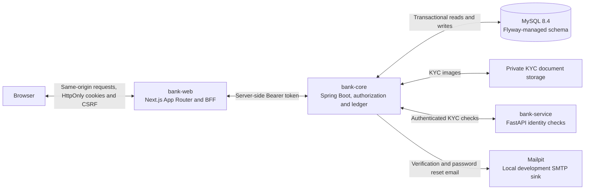

# Architecture and runtime contracts

Bank-core owns authentication, authorization, KYC cases, account balances, and ledger persistence. Bank-web owns browser presentation and the same-origin API boundary.

PayHere is disabled by default and is outside this internal transfer flow. FastAPI evaluates identity checks. All debits, credits, balances, and receipts come from bank-core and MySQL.

## Browser sessions

The browser calls the Next.js BFF on the same origin. The BFF stores the bank-core JWT in an HttpOnly cookie, forwards it upstream as a Bearer token, and keeps it out of browser JavaScript. Browser writes echo an in-memory CSRF token in `X-CSRF-Token`. The BFF checks it against its HttpOnly CSRF cookie and validates browser request context. The host-only session cookies use `SameSite=Strict` and `Path=/`. The development server supports loopback HTTP. A production-mode deployment uses Secure `__Host-` cookies and should use HTTPS.

Bank-core validates the token and active session, checks the user's current role and login eligibility, and enforces endpoint roles and resource ownership. A supported role or staff-status change revokes affected sessions in the same transaction. A later protected request with a revoked session returns `401`, and the BFF clears the browser session and requires sign-in. A valid session with insufficient permission receives `403`. A request already authorized before revocation commits can finish.

Registration requires email verification. Bank-core generates registration and reset links from `APP_FRONTEND_URL` and the email-change verification link from `APP_BASE_URL`. Point both at the web origin for local testing. Initial verification URLs carry a one-time token. The BFF redirects after processing to a token-free result page. Use the documented development script and exclude verification query strings, credentials, and request bodies from logs, traces, and recordings. A mail scanner making an ordinary GET can consume a verification link before the user opens it.

The checked-in core logging guard filters framework messages that can include credentials or tokens while retaining method, route, status, and correlation-ID diagnostics. Proxy and telemetry logs require their own configuration.

## Internal Pay and exact accounting

Pay and Transfer share the existing transfer engine. Both the write and receipt read require an authenticated CUSTOMER and the original `Idempotency-Key`.

| Endpoint | Purpose |
| --- | --- |
| `POST /api/v1/transactions/transfer` | Accepts source and destination account UUIDs and an exact positive decimal amount with up to two fractional digits. Returns the committed transfer receipt with HTTP `200`. |
| `GET /api/v1/transactions/transfer/receipt` | Looks up a committed receipt for the authenticated payer and key without writing. Returns `200`, or `404` if no matching receipt is visible yet. |
| `GET /api/v1/accounts/{id}/transactions` | Provides account-scoped history. The payer sees `TRANSFER_OUT` and the recipient sees `TRANSFER_IN` on their own accounts. |

The two accounts must be distinct, eligible, and active in LKR. The payer must own the source. Core validates funds under lock and posts using `BigDecimal` and MySQL `DECIMAL`. It commits both balance updates, the balanced journal, history projections, and the completed idempotency record together. Reusing the same key for the same payment replays its receipt. Reusing a committed key with different payment details returns `409 ERR_IDEMPOTENCY_CONFLICT`.

A timeout leaves the result uncertain. The browser reads back the original receipt first and treats `404` as a point-in-time result. A deliberate retry uses the unchanged request and key. Navigating away or reloading loses the form's in-memory recovery details. Check account history or seek help before sending another payment if the outcome remains unresolved. The original receipt gives the payer's balance at posting. The latest balance comes from a separate account read, and the receipt omits the recipient's balance.

## Account and customer operations

- **Customer opening.** The browser confirms eligibility and submits `POST /api/v1/accounts` with an `Idempotency-Key`. A matching replay returns the original account. The opening minimums are LKR 1,000.00 for savings, 0.00 for checking, and 5,000.00 for fixed deposit. If the response is uncertain, check the account list before deliberately retrying the original request with its key. An opening may still complete after an early read. Teller-assisted opening is a separate role-guarded path using the linked user UUID.
- **Staff closure.** The UI refreshes the active account before sending DELETE. Core verifies both stored and ledger-derived balances are exactly zero under the account lock. A funded account returns `422 ERR_ACCOUNT_BALANCE_NONZERO`. Closure preserves history and creates no posting. The UI reads back uncertain results without automatically repeating the DELETE.
- **Admin customer deletion.** The UI requires the exact customer UUID and checks the current record before submission. Core preserves the linked login and KYC records. Dependent accounts, including closed zero-balance accounts, block deletion. The UI reads back an uncertain result and disables further deletion on that visit if the outcome remains unconfirmed.
- **Admin journal reversal.** Core has a reversal write endpoint. Account history is insufficient to select and verify an authoritative journal entry. The web UI requires an authorized journal lookup and a reliable readback contract before it can offer reversal.

## KYC and email

The BFF maps the browser's `/api/kyc` and `/api/admin/kyc` operations to core's unversioned `/kyc` and `/admin/kyc` routes. Core authorizes case and protected file reads, stores the images, and calls bank-service using the shared server-only `BANK_SERVICE_AUTH_SECRET`. Cases can reach an Admin for human review. The Admin entry defaults to **Under review**, with other status filters available.

The onboarding form accepts one JPEG, PNG, or WebP per document type, up to 1 MiB each. The BFF preserves multipart bytes and boundaries and caps the total KYC request body at 11 MiB. Protected file responses are non-cacheable. For uncertain KYC submission, use **Refresh status** to read the stored case before retrying. The upstream review can take longer than the browser request. A `NEEDS_MORE_INFO` response currently retains the active case and its existing documents.

Mailpit captures verification and password reset messages during development. Never publish Mailpit messages or the token-bearing URLs they contain.

[Local setup](local-development.md) · [Historical PayHere routing inventory](payhere-routing.md)
