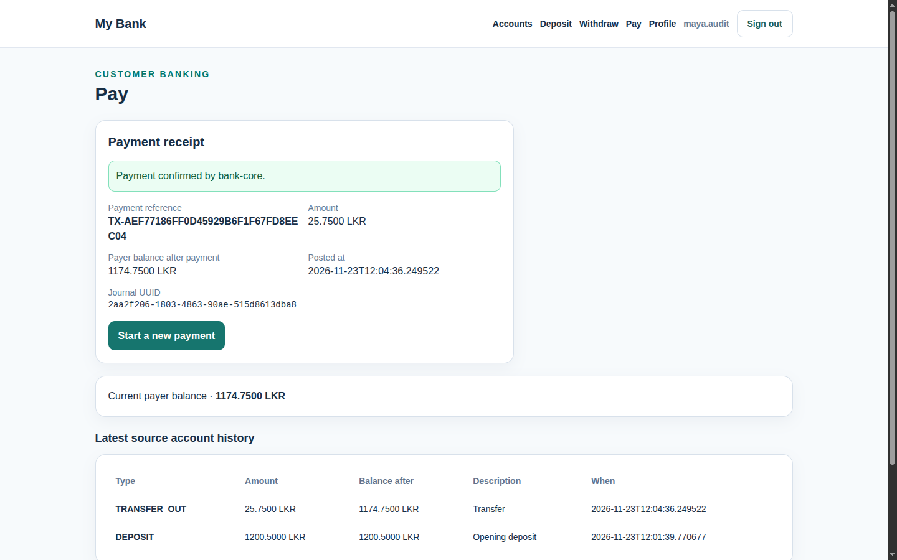

# Screenshot gallery

These are screenshots of the implemented application with disposable synthetic users, accounts, cases, and identifiers. F3 ran the production Next.js build against Spring, MySQL, Mailpit, and the portable KYC service. F4 and F5 used production Next.js with a local bank-core mock to capture the repaired views. The underlying payment and authorization evidence comes from the real-stack acceptance runs.

| Screenshot | Viewport | Evidence |
| --- | --- | --- |
| [Public home](screenshots/home.webp) | 1440 × 900 | F4 · Restored feature-card contrast |
| [Customer dashboard](screenshots/customer-dashboard.webp) | 1440 × 900 | F3 · Active savings and checking accounts with balances and history links |
| [Pay review](screenshots/pay-review.webp) | 390 × 844 | F3 · Confirm source account, exact amount, and recipient account UUID |
| [Payment receipt](screenshots/pay-receipt.webp) | 1440 × 900 | F3 · Committed LKR payment, journal reference, payer balance, and outgoing history |
| [Account history](screenshots/account-history.webp) | 390 × 844 | F3 · Server-reported balance, transfer and deposit rows, and CSV export |
| [Admin KYC queue](screenshots/kyc-review.webp) | 390 × 844 | F4 · The default Under review queue with an actionable synthetic case |
| [Staff customer directory](screenshots/staff-customers.webp) | 390 × 844 | F4 · Search and customer links with horizontal scrolling contained within the table |
| [Manager Teller lifecycle](screenshots/manager-tellers.webp) | 390 × 844 | F3 · Teller directory and entry point for assigning an existing customer |
| [Admin access directory](screenshots/admin-access.webp) | 768 × 1024 | F5 · Keyboard focus on the selected Employees tab |
| [Admin role editor](screenshots/admin-role-editor.webp) | 390 × 844 | F5 · Labeled controls, required fields, focus, and read-only login email |

The gallery covers the requested views. Timeout recovery and session revocation are described in the [demo walkthrough](portfolio-presentation.md#demo-walkthrough) and work best as live or recorded sequences. The gallery keeps one lossless WebP per view. The original PNG audit captures remain in the project workspace evidence folders.
